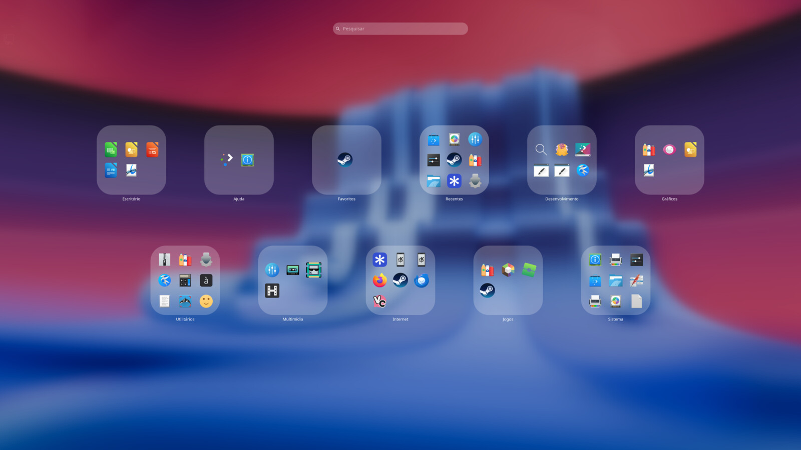
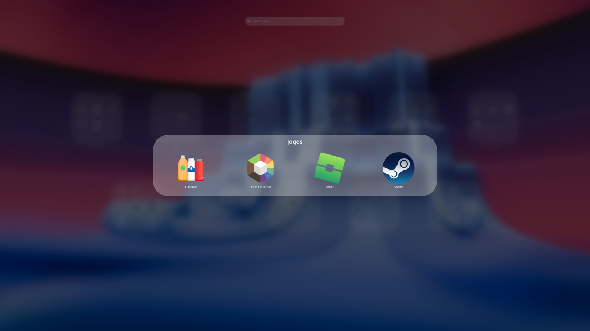
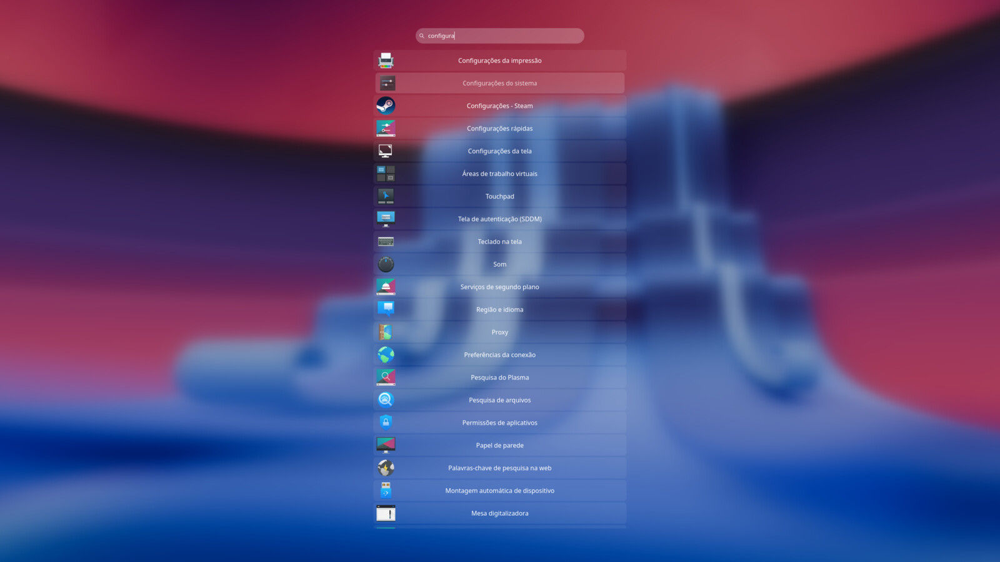
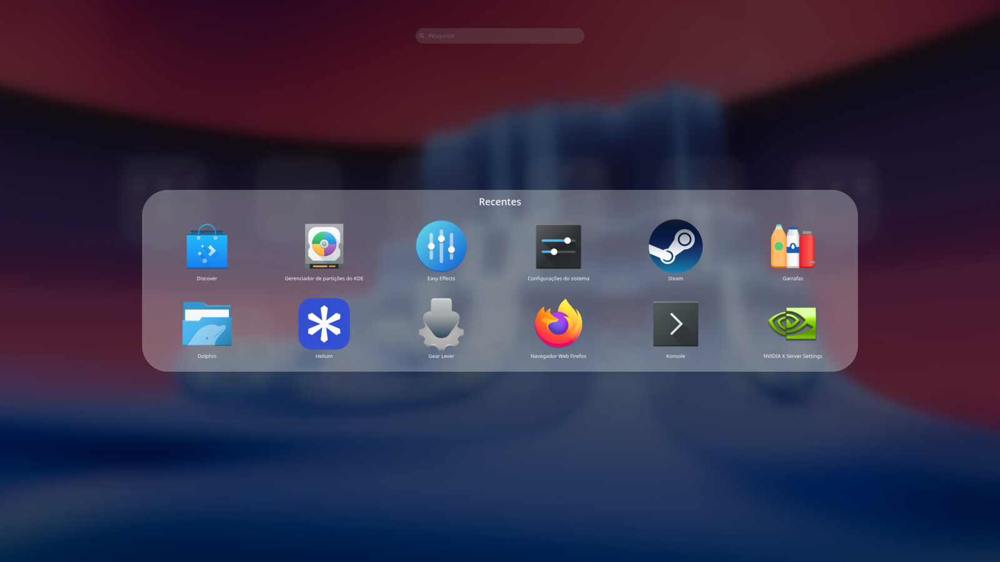
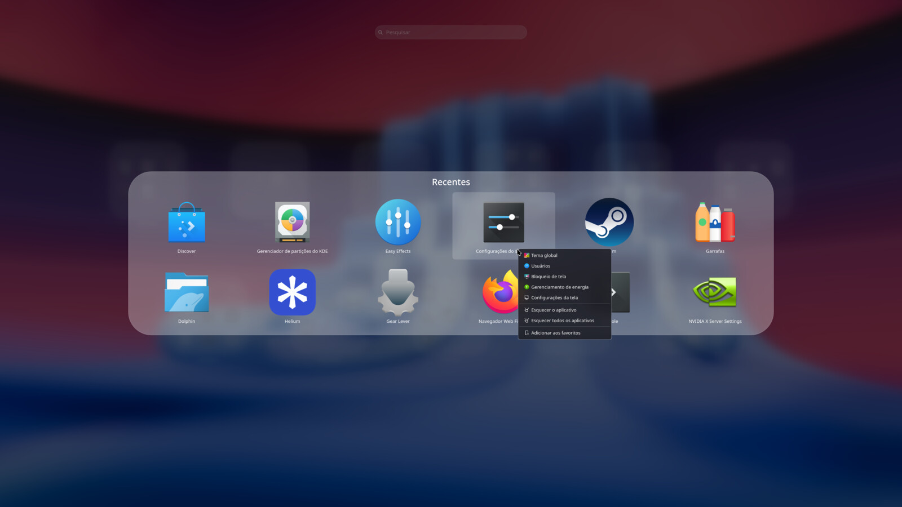

# PlasmaPad

A full-screen application launcher for KDE Plasma 6: your apps as category
folders over a blurred copy of your own wallpaper, with instant search,
favorites, recent apps and full keyboard control. It learns which categories
you use the most and puts them in the center.

Written in plain QML (no compiled plugin).

## Screenshots

| Overview | Opened folder | Search |
|:---:|:---:|:---:|
|  |  |  |

| Recent apps | Context menu |
|:---:|:---:|
|  |  |

## Features

- Category folders with a 3x3 preview of their apps. Clicking one opens it in a
  frosted panel; clicking outside, or Esc, closes it.
- **Favorites** and **Recent** folders, always in the center of the top row.
  Favorites are pinned from the right-click menu; Recent uses the system's real
  usage statistics. The categories fan out around them, the most used first
  (natural order until you have used the launcher).
- Search bar in the top center: just start typing. Results appear as a vertical
  list (icon on the left, name in the middle) and animate in and out as you type.
- Right-click menu on any app with the actions Plasma provides (add to desktop
  or panel, edit, uninstall, application-specific actions...) plus Add to /
  Remove from Favorites. Frosted-glass background, fade in and out, submenus.
- Full keyboard navigation: arrows and Tab move between folders and apps, Enter
  opens, Esc closes one layer at a time (search, folder, launcher).
- The background is your current wallpaper, detected from your desktop
  settings (dark variant on dark themes). The blur is drawn by the widget and
  fades in over the sharp wallpaper, so the desktop never jumps to a blurred
  frame. A "blur only" mode hides the wallpaper and blurs the desktop instead.
- Opens with the panel button or the Super key and covers the whole screen.
  Closes with Esc, a click on empty space, launching an app, or when another
  window takes focus (Alt+Tab).
- Always up to date: apps come straight from the system's application menu, so
  installing or removing an application updates the launcher automatically.
- Settings: panel icon (fit to the panel or a custom size), launcher icon size
  (60% to 160%; the folders grow with the icons), and the background mode.
- Translations: Brazilian Portuguese, German, French, Spanish, Russian,
  Simplified Chinese, Italian, Polish, Japanese, European Portuguese, Dutch,
  Turkish, Ukrainian, Czech, Korean and Traditional Chinese.

## Requirements

- KDE Plasma 6 (developed and tested on Plasma 6.7, Wayland, Solus).
- `plasma-desktop`, which provides the application model the launcher uses.
- `kreadconfig6` to find the wallpaper.
- Only to build a release: `zip` and `gettext` (`msgfmt`, `xgettext`).
  `plasma-sdk` (`plasmoidviewer`) is handy for development.

## Installation

From a release file:

```sh
kpackagetool6 --type Plasma/Applet --install io.github.khryzantema.plasmapad-0.1.0.plasmoid
```

From a clone of this repository:

```sh
kpackagetool6 --type Plasma/Applet --install .     # first time
kpackagetool6 --type Plasma/Applet --upgrade .     # updates
```

`--upgrade` does not delete files that no longer exist, so after a big change
use `--remove io.github.khryzantema.plasmapad` followed by `--install`.

Then right-click the panel → **Add or Manage Widgets…** → search for
**PlasmaPad** and drag it to the panel. After installing or upgrading, restart
Plasma to load the new version:

```sh
plasmashell --replace
```

## Usage

| Action | Result |
| --- | --- |
| Click the panel button / press Super | Open or close the launcher |
| Click a folder | Open it |
| Click an app | Launch it and close the launcher |
| Right-click an app | Context menu |
| Type anything | Search (arrows to move, Enter to launch) |
| Arrows, Tab, Enter | Navigate folders and apps with the keyboard |
| Esc | Clear the search, then close the folder, then close the launcher |
| Click on empty space | Close the folder, then the launcher |

## Configuration

Right-click the panel button → **Configure PlasmaPad…**:

- **Panel icon**: choose one, reset to the default (the KDE icon) or remove it.
- **Icon size**: fit to the panel thickness (default), or a custom size with a
  slider (16 to 64 px).
- **Background**: blurred wallpaper (default), or *blur only*, which hides the
  wallpaper and blurs the desktop behind the launcher.
- **Launcher icon size**: 60% to 160%. The folders scale with the icons, so
  bigger icons mean bigger folders (what does not fit scrolls).

## How it works

- `contents/ui/main.qml`: the panel widget. Owns the application, favorites and
  recent models, finds the wallpaper, keeps the category usage counts, and
  creates the launcher window.
- `contents/ui/PanelButton.qml`: the button in the panel.
- `contents/ui/LaunchpadDialogWindow.qml` / `LaunchpadBlurWindow.qml`: the
  full-screen window (default and blur-only).
- `contents/ui/LaunchpadContent.qml`: what is inside the window: fade, keyboard,
  close on focus loss. It is created once and reused, so opening is only a fade.
- `contents/ui/Backdrop.qml`: the wallpaper, with the blur rendered once into a
  texture so the animation is cheap.
- `contents/ui/LaunchpadView.qml`: the layout. Contains `SearchBar`,
  `SearchResults`, `FolderGrid` (with `FolderTile`), `FolderPanel` (with
  `AppTile`) and `ContextMenuHost` (two alternating `ContextMenu`s with a
  `MenuBackground`).
- `contents/ui/ConfigGeneral.qml`, `contents/config/`: settings page and schema.
- `contents/code/wallpaper.sh`: prints the path of the current wallpaper. It is
  called asynchronously through the `executable` engine of
  `org.kde.plasma.plasma5support`. To check it on its own:

  ```sh
  sh contents/code/wallpaper.sh 2560 1440
  ```

Decisions that are not obvious from the code:

- **Full screen**: the default widget popup cannot be full screen, so the
  launcher is a background-less `PlasmaCore.Dialog` the size of the screen and
  kept on top, which covers the panels. Placing a window above a blur and below
  the panels is not possible without a KWin script.
- **No popup**: `activationTogglesExpanded` is off and the full representation
  is the same button, so pressing Super opens only the launcher.
- **Sub-models**: a category's apps are only available after a view has visited
  its row, so `FolderGrid` keeps a hidden `Repeater` over the model and polls
  until every folder has its apps. It does it again when the app list is rebuilt.
- **Animated search**: the search backend replaces its whole result model on
  every keystroke, so `SearchResults` mirrors it into a `ListModel` by result
  name (remove, insert, move), which lets the list animate.
- **Cheap and fast**: the blur is computed once, the decoded wallpaper is kept
  in the pixmap cache and the content is created once, so the first frame after
  asking to open comes after about 10 ms (about 120 ms on the first opening of
  a session). The cost is a few tens of MB of memory while the launcher is closed.
- **Wallpaper**: `wallpaper.sh` reads the Image of the desktop containment from
  `plasma-org.kde.plasma.desktop-appletsrc`, falls back to the look-and-feel
  default, picks the dark variant on dark themes, and the closest aspect ratio
  for packages with several resolutions.

## Private APIs used

| Feature | Module | Status |
|---|---|---|
| Categories and apps, search, favorites, recent apps | `org.kde.plasma.private.kicker` (plasma-desktop) | private |
| "Blur only" window | `Kicker.DashboardWindow`, same module | private |
| Running the wallpaper script | `org.kde.plasma.plasma5support` | public |
| Wallpaper location | `plasma-org.kde.plasma.desktop-appletsrc` | internal file format |

The private module is the one the launchers shipped with Plasma are built on,
but it has no stability promise: a future Plasma release may change it.

## Known limitations

- The launcher covers the panels; they cannot be shown over it.
- The background supports the static wallpapers of the default image plugin.
  Slideshows and Picture of the Day fall back to the default wallpaper.
- Multi-monitor: it opens on the screen of the panel that owns the button.
- Closing when another window takes focus relies on the window activation
  reported by Wayland.
- The translations were written without a native review, so corrections are
  welcome.

## Development

```sh
plasmoidviewer -a io.github.khryzantema.plasmapad -f horizontal   # quick test, no panel needed
plasmashell --replace                                       # reload in the real panel
```

`plasmoidviewer` does not catch every problem (a wrong QML import, for example,
only fails in the real panel), so confirm in the shell and check
`journalctl --user -b | grep -i plasmapad`.

- `./package.sh`: rebuilds the translations and creates
  `io.github.khryzantema.plasmapad-<version>.plasmoid` (the version comes from
  `metadata.json`).
- Translations: user-visible strings are English in the code (`i18n()`).
  `po/extract.sh` refreshes the `po/*.pot` template, `msgmerge -U po/<lang>.po
  po/*.pot` updates a language, and `po/build.sh` compiles every `po/<lang>.po`
  into `contents/locale/<lang>/LC_MESSAGES/`. To add a language, copy the
  template to `po/<lang>.po`.

## License

GPL-2.0-or-later. See [LICENSE](LICENSE).
